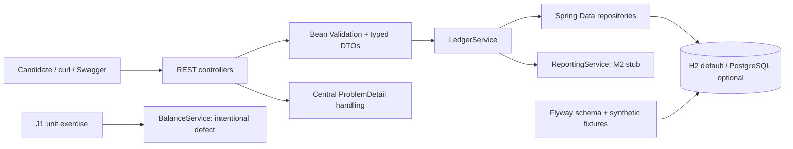
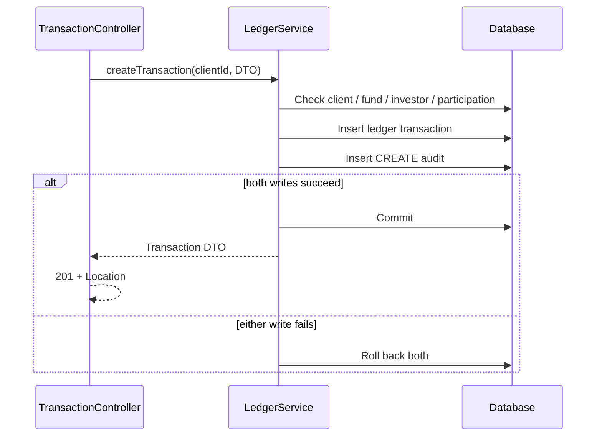

# Architecture

V0.1 is a layered modular monolith in one Spring Boot process and one relational database. It uses conventional Spring MVC, constructor injection, service transaction boundaries, Spring Data JPA, Flyway, and typed Java record DTOs. No queue, cloud integration, identity provider, or custom framework is needed.

| Package under `com.interview.ledger` | Responsibility |
|---|---|
| `controller` | HTTP routes, request binding, creation responses |
| `dto` | Request/response records; no entity serialization |
| `service` | Use cases, explicit client scoping, transaction boundaries |
| `repository` | Client-scoped persistence queries |
| `model` | Six JPA entities and domain enums |
| `exception` | ProblemDetail, validation errors, conflicts, exercise 501 |
| `configuration` | OpenAPI metadata |

Related objects are represented by scalar foreign-key IDs in the starter entities. This keeps client predicates and SQL relationships explicit and avoids lazy-loading graphs in a small interview project. Flyway composite foreign keys enforce the relationships. A candidate may discuss or introduce entity associations when justified; a custom aggregate or repository framework is unnecessary.

`LedgerService` uses read-only transactions by default and write transactions on creation methods. A financial insert and its CREATE audit insert share a transaction. `saveAndFlush` makes constraint failures observable before returning a successful response. Database uniqueness, rather than a race-prone existence check alone, arbitrates duplicate records. HTTP DTO validation is the boundary for amount scale and request format; the database enforces monetary positivity and referential integrity.

The current atomic baseline is intentional. Planned M3 will supply a separate defective variant; V0.1 does not introduce a rollback defect into ordinary financial writes.

## Exercise boundaries

- J1: `BalanceService.calculate` is intentionally wrong; no other baseline operation uses it.
- J2: only the investor POST request and successful response are intentionally incomplete. Fund and transaction validation demonstrate ordinary framework behavior.
- M2: ownership and date checks work, then `ReportingService.report` throws an explicit exercise exception mapped to 501. Its future calculation must be independent of J1.

## Security and operational scope

There is **no authenticated security context**. Every existing query scopes records to the client in the URL, and cross-client references are rejected. This provides record scoping and integrity, not proof the caller may act for that client. S2's trusted authentication context and isolated vulnerable variant remain planned. The app listens on `127.0.0.1`; health exposes no database details. H2 console is not enabled. Only health/info actuator endpoints are exposed.

Data volume is intentionally small. Current participation list mapping may perform per-record lookups and transaction listing loads the client's full list. These limitations are visible discussion topics; M1 will address database pagination. There is no idempotency, write-period locking, financial update/delete API, general audit snapshot, or production authentication.
