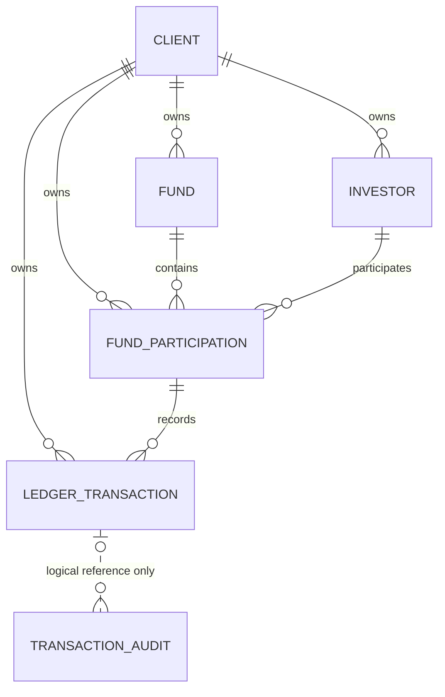

# Database and synthetic ledger

Flyway owns all DDL. Hibernate runs `ddl-auto: validate`; it does not create or repair the schema. The same migrations are exercised on H2 in PostgreSQL compatibility mode and real PostgreSQL.

| Table | Important columns and constraints |
|---|---|
| `clients` | Identity `id`, required `name`, checked ACTIVE/INACTIVE `status` |
| `funds` | `client_id` FK, required `name`, optional `description`, `created_at`; unique `(client_id,name)` and `(client_id,id)` |
| `investors` | `client_id` FK, required `name`,`email`,`created_at`; unique `(client_id,email)` and `(client_id,id)` |
| `fund_participations` | Required client/fund/investor IDs and `created_at`; unique `(client_id,fund_id,investor_id)`; composite FKs enforce same-client fund/investor ownership |
| `ledger_transactions` | Required client/fund/investor IDs, `transaction_type`,`amount`,`transaction_date`,`created_at`; optional description; composite FK to an existing participation |
| `transaction_audits` | Required logical `transaction_id`, checked CREATE/UPDATE/DELETE `operation`, `created_at`; no transaction FK so evidence survives deletion |

All IDs are `BIGINT GENERATED BY DEFAULT AS IDENTITY`. Fixtures use explicit IDs below 1000; generated values start at 1000, avoiding sequence resets and collisions on either engine. Timestamps use `TIMESTAMP WITH TIME ZONE` mapped to `Instant`. Business dates use SQL `DATE` mapped to `LocalDate`; they have no timezone conversion.

Amounts use `NUMERIC(19,2)` and Java `BigDecimal`: positive, up to 17 integer digits and two fractional digits. HTTP validation rejects more than two fractional digits rather than silently rounding. SQL numeric scale may round direct SQL inputs; direct database writes are outside the HTTP input contract. Calculated balances may be negative. No currency conversion, valuation, units/shares, double-entry accounting, or payment integration is included.

| Transaction type | Direction |
|---|---|
| CONTRIBUTION | CREDIT |
| INTEREST_INCOME | CREDIT |
| DISTRIBUTION | DEBIT |
| GENERAL_EXPENSE | DEBIT |
| MANAGEMENT_FEE | DEBIT |

`TransactionType` encapsulates direction. Financial contracts define balance as total credits minus total debits. The starter J1 implementation deliberately violates that rule. USD is a domain-wide constant in V0.1; no per-record currency field is needed.

## Uniqueness and normalization

Investor email is trimmed and lowercased with `Locale.ROOT` before storage, including duplicate checks enforced by the unique constraint. SQL checks require stored email to equal its lowercase/trimmed form. For this interview domain the entire address is treated case-insensitively; provider-specific alias rules are not applied. J2 still needs email-format and blank-input validation. Valid synthetic addresses use `example.test`.

Fund and investor display names are trimmed when created. Fund name uniqueness is case-sensitive within a client (`Growth Fund` and `growth fund` differ). Email and fund-name reuse across different clients is permitted. A client cannot write while INACTIVE (409), but its existing records remain readable. These are explicit starter decisions.

## Fixtures

`db/migration/V1__create_ledger.sql` creates the schema. `db/demo/V2__synthetic_demo_data.sql` inserts fixed fictional records. Default Flyway locations include both directories; the demo profile is intended solely for this interview application. Existing versioned migrations run once per database; repeated initialization does not reinsert fixtures. Never edit an applied migration: add a new one, or deliberately reset a disposable demo database.

| Client | Fund IDs | Investor IDs | Participations |
|---|---|---|---|
| 1 — Client Alpha | 1 Growth Fund; 2 Income Fund | 1 Alice Morgan; 2 Bob Carter; 3 Carol Rivera | Alice and Bob → Growth; Carol → Income |
| 2 — Client Beta | 3 Infrastructure Fund; 4 Opportunity Fund | 4 Daniel Smith; 5 Emma Wilson | Daniel → Infrastructure; Emma → Opportunity |

Totals: **2 clients, 4 funds, 5 investors, 5 participations, 8 transactions, 8 CREATE audits**. Carol participates in Income Fund without transactions. All Income Fund reports should therefore be zero.

Growth Fund (client 1, fund 1) contains **exactly** the dedicated six transactions:

| ID | Investor | Date | Type | Amount |
|---|---|---|---|---:|
| 1 | Alice | 2026-02-10 | CONTRIBUTION | 1000.00 |
| 2 | Alice | 2026-03-05 | CONTRIBUTION | 500.00 |
| 3 | Alice | 2026-03-10 | INTEREST_INCOME | 50.00 |
| 4 | Alice | 2026-03-15 | DISTRIBUTION | 200.00 |
| 5 | Alice | 2026-03-20 | MANAGEMENT_FEE | 25.00 |
| 6 | Bob | 2026-04-01 | CONTRIBUTION | 300.00 |

Beta's independent records: Infrastructure contribution 700.00 on 2026-03-05; Opportunity expense 12.34 on 2026-03-07. These make tenant leakage and negative-balance reasoning observable. Fixed transaction and creation dates keep fixtures reproducible.

Composite unique keys supply client/fund lookup prefixes. Additional indexes cover `(client_id,investor_id,fund_id)` for reverse participation lookup; client/fund/date, client/investor/date and client/date transaction ordering; and audit transaction lookup. Performance tuning and query plans remain future discussion topics.

Audit IDs are retained independently from transactions. V0.1 writes CREATE evidence only. UPDATE/DELETE enums reserve vocabulary for future work; no corresponding API or complete audit lifecycle is claimed. IdempotencyRecord and ReportingPeriod are intentionally absent.
