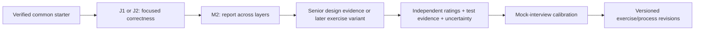

# Proposal: standardized Java live coding interview pilot

**Decision requested:** review the V0.1 demonstration and approve a small internal mock-interview pilot, named ownership, and calibration time. This is a personal engineering proposal using original code and synthetic data. It is not an approved hiring process, and no improvement in hiring outcomes has been established.

## Problem and opportunity

Traditional take-home assignments can require substantial unpaid candidate time, vary widely in effort and environment, and create repository-review overhead. They provide limited visibility into how a candidate reasons, responds to feedback, and verifies work independently. Unequal access to time, coaching, or AI tools can make outputs difficult to compare. Take-homes can still support candidates who prefer asynchronous work or need scheduling flexibility; a live format should not eliminate appropriate accommodations.

A small existing application makes a live session focus on backend engineering work: investigate a defect, validate an API, query a database, calculate a report, or reason about a failure. A consistent starter, explicit contracts, and common evaluation anchors can improve comparability. Those are intended benefits to measure, not proven effects.

## Proposed approach

Use a 60-minute adaptive session with a working Java 21/Spring Boot ledger. Two clients and deterministic fictional financial records provide realistic relationships without employer systems or customer data. The H2 default has no Docker requirement; optional PostgreSQL tests make engine-specific behavior testable.

Junior exercises assess decimal reasoning, Java fundamentals, validation, HTTP behavior, and tests. Mid-level work adds date boundaries, repository design, aggregate calculations, and scalability. Planned senior variants add idempotency under concurrent retries, trusted tenant authorization, and period locking. Progression reveals the complexity a candidate can handle independently; completing more tasks quickly is not the sole measure of seniority. Senior recommendations require demonstrated senior competencies.

The delivered V0.1 includes runnable J1, J2 and M2 exercises, passing baseline tests, public acceptance examples, schema/fixtures, API documentation, and CI configuration. M1/M3/S1/S2/S3 have specifications only. A fifteen-minute senior discussion during V0.1 can identify reasoning and gaps, but cannot substitute for a tested reliability guarantee. The separate private interviewer kit remains future work.

## Objective evidence and interviewer judgment

Baseline tests establish that the starting environment works; candidates should not lose assessment time repairing setup. Public exercise tests make expected outcomes visible, such as signed balances, rejected-input side effects, and March report boundaries. A future private suite can broaden coverage after separate approval. Test results should be retained as evidence with the task version and assistance history.

Automated tests are objective about the scenarios they execute. They do not fully assess architecture, independence, code ownership, communication, or general production readiness. Reviewers should inspect tests, observe investigation and correction, ask the candidate to explain a change, and distinguish independent reasoning from directed help. Standardize and record assistance, allow quiet thinking, and require supporting examples for each rating. Keep hiring notes and hidden materials outside the public starter.

Use the published weighted rubric (Java 15%, API 15%, persistence 15%, problem-solving 15%, testing 15%, communication 10%, architecture 15%). Unassessed competencies remain unassessed; report coverage, avoid treating missing evidence as zero, and apply senior competency gates. Numeric thresholds are provisional until calibration.

## Session structure and AI proposal

| Minutes | Activity |
|---|---|
| 0–5 | Introduction and environment verification |
| 5–20 | Junior exercise |
| 20–40 | Mid-level exercise, adapted to observed evidence |
| 40–55 | Senior exercise scope or explicitly labeled design discussion |
| 55–60 | Candidate questions |

Candidates are not expected to complete all exercises. Share the policy and starter setup before the interview; pause assessment for environment failures and provide accommodations or a follow-up when evidence is incomplete.

For initial calibration, use **independent coding**: official documentation and conventional IDE completion allowed, generative AI disabled. This gives a consistent starting track for assessing unaided debugging and reasoning. Separately pilot **AI-assisted coding** with equal tool access and explicit disclosure: candidates remain responsible for reviewing, explaining, testing and correcting generated code. Do not mix scores across modes before calibration. These options require management approval and do not assert an existing employer policy.

## Pilot and iteration

1. Assign one engineering owner and two or more participating interviewers. Review scope, accessibility, proposed policy and personal-project ownership before use.
2. Run six to eight internal mock interviews across experience levels. Rotate interviewers and tasks; use a second independent evaluator on a subset. This small sample is for usability/calibration, not statistical claims about hiring quality.
3. Record setup and interview timings, evidence coverage, assistance, difficulty, candidate experience, and independent ratings before debriefing. Do not place participant notes or recordings in this repository.
4. Review disagreements and floor/ceiling effects; revise written requirements, time allocations, variants, and anchors. Version changes and rerun reliability checks. Build private hints/acceptance materials separately.
5. Present results and remaining uncertainty to management. Only after explicit approval move to a limited candidate pilot with continued accommodations and review.

Provisional effort assumptions for planning: an owner spends roughly one working day organizing mocks and reviewing results, each mock consumes one interview hour plus a short debrief, and interviewers need one practice session. These are planning estimates to replace with pilot measurements. No paid services or added infrastructure are proposed.

## Success metrics and decision criteria

Collect a baseline for comparable current interviews if available and permitted. Do not infer causation from a small mock sample. Proposed thresholds below are pilot targets, not delivered outcomes.

| Metric | Definition / collection | Provisional target or review trigger |
|---|---|---|
| Candidate setup time | Median and slowest setup time after JDK is available; separate dependency download time | Median ≤10 minutes; investigate every failure |
| Interview duration | Actual duration and deviations from 60-minute plan | Typical session ≤65 minutes; assess unfinished core evidence |
| Interviewer preparation | Minutes per session after initial training | Median ≤15 minutes |
| Evaluation time | Minutes from session end to written evidence-based recommendation | Median ≤15 minutes |
| Baseline reliability | Successful clean baseline runs / attempted runs, by OS/JDK | 100% in pilot sample; any reproducible failure blocks candidate pilot |
| Inter-rater agreement | Level agreement and per-category rating differences for independently double-scored mocks | Investigate any level gap or category gap >1; refine anchors |
| Candidate experience | Voluntary short survey on clarity, relevance, pressure and accessibility | Review each concern; suggested median clarity ≥4/5 |
| Difficulty distribution | Exercise success, assistance level, time and boundary-test coverage by intended level | Identify floor/ceiling effects; no universal completion quota |
| Evidence coverage | Assessed rubric weight and missing role-critical competencies | No final level claim where required evidence is missing |

Proceed only when setup is reliable, core instructions are clear, evaluators can explain disagreements, accessibility concerns have a response, and enough role-relevant evidence fits the session. Revise or stop the pilot if these conditions are unmet. Longer-term hiring outcomes would need separate, appropriately governed evaluation; this proposal makes no predictive-validity claim.

## Risks and limits

| Risk | Mitigation / remaining limit |
|---|---|
| Live coding pressure obscures ability | Provide setup in advance, quiet time, accommodations, and follow-up options |
| Inconsistent prompting or affinity bias | Record assistance, independent initial scoring, observable anchors, evaluator calibration |
| Public exercises become memorized | Require explanation and a small extension; develop private variants separately |
| AI access changes what is measured | Declare modes in advance, equalize access, evaluate verification, calibrate separately |
| Public tests reward narrow solutions | Inspect reasoning/tests; add private acceptance coverage later without publishing it |
| Senior skills exceed session time | Use explicit design evidence and dedicated follow-up; never infer seniority from aggregate score alone |
| H2 differs from PostgreSQL | Maintain opt-in real-engine checks; reserve concurrency claims for PostgreSQL failure/concurrency tests |
| Dependency maintenance | Pin/document compatible versions; requested Boot 3.5 line is at end of OSS support; review upgrade before wider adoption |
| Public ownership or confidential-data confusion | Keep original synthetic code in a personal repository; review publication and licensing before publishing |

The starter demonstrates feasibility and supplies measurable interview behaviors. Management approval, interviewer calibration, a private interviewer kit, and a controlled candidate pilot remain necessary before operational adoption.
